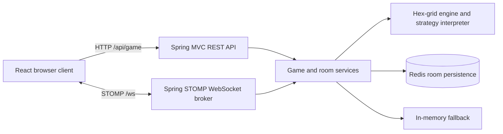

# Kombat x Demon Slayer

A full-stack, turn-based strategy game with a hexagonal battlefield, Human and Demon factions, programmable minion strategies, and multiplayer room coordination. This monorepo brings the existing React client and Spring Boot server together while preserving both projects' original commit histories.

## Key Features

- **Three game modes:** Duel (player vs player), Solitaire (player vs bot), and Auto (bot vs bot).
- **Battle preparation:** faction selection, configurable game rules, minion types, and strategy setup.
- **Hex-grid gameplay:** territory purchases, minion spawning, player actions, turn phases, and battle status displays.
- **Programmable strategies:** a Java tokenizer, parser, and evaluator support strategy expressions, assignments, conditionals, loops, movement, and shooting.
- **Multiplayer rooms:** room creation and joining, coordinated setup, and game actions over STOMP/WebSocket.
- **Room persistence:** Redis-backed room state, seeds, event history, and snapshots. The existing server falls back to process-local memory when Redis is unavailable; that fallback is lost on restart.

These features are identified in the source code. Full multiplayer and production deployment validation are separate from the build checks documented below.

## Tech Stack

| Layer | Technologies |
| --- | --- |
| Frontend | React 19, TypeScript 5.9, Vite 7, Tailwind CSS 3, native Fetch and WebSocket |
| Frontend tooling | npm lockfile, ESLint 9, React Hooks lint rules |
| Backend | Java 21 target, Spring Boot 4.0.2, Spring MVC, Spring WebSocket/STOMP |
| Persistence | Spring Data Redis, Lettuce, Redis |
| Backend tooling | Maven Wrapper 3.9.12, JUnit Jupiter, Spring Boot tests |
| Deployment configuration | Vercel frontend configuration, Render Blueprint, multi-stage Java 21 Dockerfile |

Dependency versions and application scripts remain those of the source repositories. See each package manifest and lockfile for exact dependency resolution.

## System Architecture



REST controllers handle configuration, setup, and game commands. WebSocket controllers coordinate room membership, setup, actions, and room topic updates. The game engine and strategy interpreter run on the backend.

## Repository Structure

```text
kombat-x-demonslayer/
|-- frontend/
|   |-- src/                 # React screens, API client, STOMP client, assets
|   |-- public/
|   |-- docs/                # Existing frontend notes
|   |-- .env.example
|   |-- package.json
|   |-- package-lock.json
|   |-- vercel.json
|   `-- vite.config.ts
|-- backend/
|   |-- src/main/java/       # Controllers, services, engine, room persistence
|   |-- src/main/resources/  # Spring application configuration
|   |-- src/test/java/
|   |-- .mvn/wrapper/
|   |-- .env.example
|   |-- pom.xml
|   |-- mvnw
|   |-- mvnw.cmd
|   `-- Dockerfile
|-- docs/
|   |-- MIGRATION.md
|   `-- VERIFICATION.md
|-- render.yaml
|-- .gitignore
`-- README.md
```

Existing backend strategy examples and HTTP request files are retained. There are no nested Git repositories. The redundant `frontend-kombat` wrapper directory has been flattened.

## Local Development Setup

Prerequisites:

- Node.js 22.12 or newer and npm (the migration used Node 22.14.0 and npm 11.1.0).
- JDK 21 and a working `JAVA_HOME`. The Maven project targets Java 21; the migration machine's build uses JDK 23.0.2.
- Redis on `localhost:6379` for durable room storage. The existing memory fallback can be used for temporary local experiments.
- Docker is optional for containerized backend execution.

Clone this monorepo after it has been published, or use the prepared local checkout. Open separate terminals for the frontend and backend.

## Environment Variables

### Frontend

Copy `frontend/.env.example` to `frontend/.env.local`:

```dotenv
VITE_API_BASE_URL=http://localhost:8080/api/game
VITE_WS_URL=ws://localhost:8080/ws
```

`VITE_API_BASE_URL` includes `/api/game`; `VITE_WS_URL` includes `/ws`. Vite embeds these public URLs at build time. Restart the dev server or rebuild after changes. Never place credentials in `VITE_` variables.

Without an override, localhost clients connect to port 8080 on the same hostname. Other hostnames use the legacy Render endpoint in the source code. Configure both variables explicitly for each deployment.

### Backend

| Variable | Default | Purpose |
| --- | --- | --- |
| `PORT` | `8080` | HTTP and WebSocket listener |
| `REDIS_HOST` | `localhost` | Redis host |
| `REDIS_PORT` | `6379` | Redis port |
| `REDIS_USERNAME` | empty | Optional Redis username |
| `REDIS_PASSWORD` | empty | Optional Redis password; configure outside Git |
| `CORS_ALLOWED_ORIGIN_PATTERNS` | Local port 5174 origins and the legacy Vercel origin | Comma-separated allowed browser origins for REST and WebSocket |

`backend/.env.example` documents these names. Spring Boot does **not** automatically load that file. Export the variables in your shell or configure them in the hosting dashboard. With local Redis and port 5174, the existing defaults are sufficient.

Example PowerShell configuration:

```powershell
$env:REDIS_HOST = 'localhost'
$env:REDIS_PORT = '6379'
$env:CORS_ALLOWED_ORIGIN_PATTERNS = 'http://localhost:5174'
```

For LAN testing, set the frontend variables to the backend computer's address and allow the frontend's actual origin in backend CORS settings. The frontend dev proxy forwards `/api`, but explicit API URLs are used by the client when configured.

## How to Run Frontend

```sh
cd frontend
npm ci
npm run dev
```

Open the local URL printed by Vite, normally `http://localhost:5174`. If Vite selects another port, update the backend CORS origins to match.

```sh
npm run build    # TypeScript checks and production output in dist/
npm run preview # Preview the production bundle
npm run lint    # Existing ESLint rules; see verification results
```

The frontend has no automated test script in its source manifest.

## How to Run Backend

Windows PowerShell:

```powershell
cd backend
.\mvnw.cmd spring-boot:run
```

Linux or macOS:

```sh
cd backend
sh ./mvnw spring-boot:run
```

Build and run the existing tests:

```powershell
.\mvnw.cmd verify
```

On Linux/macOS, use `sh ./mvnw verify`. A successful package creates `backend/target/Kombat-backend-0.0.1-SNAPSHOT.jar`.

Health check:

```sh
curl http://localhost:8080/api/hello
```

From the repository root, an optional Docker build uses the backend directory as its context:

```sh
docker build -t kombat-backend ./backend
docker run --rm -p 8080:8080 --env-file backend/.env.local kombat-backend
```

Create `backend/.env.local` from the example only if using this Docker command, and set `REDIS_HOST` to an address reachable from inside the container. On Docker Desktop, a Redis server running on the host can be reached using `host.docker.internal`. Docker loads `--env-file`; a direct Java or Maven launch requires exported environment variables.

## API Integration

| Interface | Routes or destinations | Role |
| --- | --- | --- |
| Health | `GET /api/hello` | Lightweight server response |
| REST base | `/api/game` | Game configuration and commands |
| Setup | `/config`, `/mode`, `/character`, `/setup/full/{playerId}`, `/init-full`, `/setup` | Configure and inspect game setup |
| Gameplay | `/start`, `/current-player`, `/end-turn`, `/state`, `/spawn`, `/buy-hex`, `/status`, `/phase`, `/reset` | Game flow and state |
| WebSocket handshake | `/ws` | Native WebSocket carrying STOMP frames |
| Client messages | `/app/create-room`, `/app/join-room`, `/app/start-game`, `/app/player-action` | Room lifecycle and gameplay |
| Room updates | `/topic/room/{roomId}` | Room-specific updates |

See `backend/src/main/java/com/kombat/kombatbackend/controller/GameApiController.java` for HTTP methods and request DTOs, and `websocket/GameWebSocketController.java` for all message mappings. The frontend's `src/api/gameApi.ts` and `src/ws/stompWs.ts` define its integration behavior.

## Deployment Information

The repository contains deployment configuration; this migration does not claim that a new production deployment has been completed.

### Vercel

Create a project for this repository and choose **Root Directory: `frontend`**. `frontend/vercel.json` selects Vite, `npm run build`, and `dist`. Set:

- `VITE_API_BASE_URL=https://YOUR-BACKEND-HOST/api/game`
- `VITE_WS_URL=wss://YOUR-BACKEND-HOST/ws`

Redeploy after changing build-time variables. Root directory selection follows the [Vercel monorepo documentation](https://vercel.com/docs/monorepos).

### Render

The root `render.yaml` declares the existing Docker service configuration with **`rootDir: backend`**, Dockerfile `./Dockerfile`, and Docker context `.`. Those paths are relative to the configured service root, as described in [Render monorepo support](https://render.com/docs/monorepo-support).

For a new Blueprint, review its service name and supply Redis and CORS variables during setup. For a dashboard-managed service, select the new repository and `main`, set Root Directory to `backend`, and confirm the Dockerfile and context above. Set `CORS_ALLOWED_ORIGIN_PATTERNS` to the new frontend origin. The health check is `/api/hello`.

Existing Vercel and Render services have not been changed. Legacy endpoint strings remain in application fallbacks for compatibility; their availability was not tested. Redis persistence and a complete multiplayer session require separate runtime validation.

## Migration and Verification

Both source `main` branches were imported through unsquashed subtree-style merges. Original commit IDs remain ancestors of this repository's `main`; source feature branches were inventoried but not merged or published. See [migration details](docs/MIGRATION.md) and the [verification report](docs/VERIFICATION.md) for source revisions, checks, limitations, and publishing status.

## Contributors

The source commit histories contain these author names:

- `namnueaNO.1`
- `namnueatechtitan`
- `lntechfuse`

These are Git author names, not independently verified identities or assigned project roles. The two similarly named authors may represent the same person.
